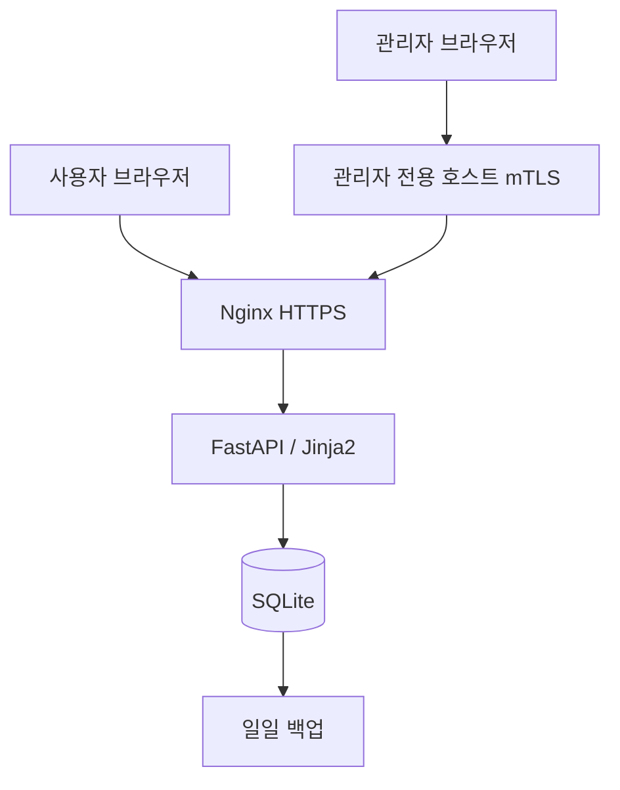

# 시스템 설계

사용자 호스트는 관리자 페이지/API를 차단한다. 관리자 호스트는 인증서 검증 성공 시에만 관리자 경로를 프록시한다. FastAPI는 loopback 또는 Unix socket으로만 바인딩하고 관리자 접근 신호는 신뢰된 Nginx가 덮어쓴 내부 헤더로 전달한다. 애플리케이션도 기본 거부하며 직접 접속을 금지한다.

## RS-001 초기 구현 경계
`app.main.create_app(settings=...)`가 앱 팩토리이자 `uvicorn --factory` 진입점이다. 불변 `Settings`는 앱별 `app.state.settings`에 보관한다. import/앱 생성/lifespan은 DB 생성·접속 및 외부 연결 없이 동작한다. 설정 우선순위와 필드는 README를 따른다. 템플릿/정적 파일 및 상대 DB 경로는 소스 위치를 기준으로 해석한다. 현재 관리자 접근 설정은 `deny`만 지원하고 관리자 경로는 404다. 위 프록시 접근 신호·mTLS·Origin/CSRF 설계의 구현 및 검증은 RS-006/008에 남아 있다.

## UI
사용자 `/`: 월 캘린더(가능/예약/불가/과거/선택), 선택 날짜 목록, 이름, 메모, 예약 버튼, 성공 화면 및 취소 토큰, 취소 폼. 모바일 우선; 상태는 색상 외 문자로 구분. 월을 넘겨 선택한 날짜도 유지. 실패 시 날짜 목록 갱신 및 안내.
관리자 `/admin`: 월별 캘린더 및 리스트, 예약 생성/수정/취소, 차단일 관리, 로그, 설정. 삭제 확인 및 오류 표시.

## DB 모델
- reservations: id UUID, name, memo, cancel_token_hash, status (CONFIRMED/CANCELLED), created_at, cancelled_at
- reserved_dates: date TEXT PRIMARY KEY, reservation_id FK nullable, type RESERVED/BLOCKED, memo; CHECK로 type과 FK null 여부 연계
- reservation_logs: id, reservation_id nullable, action, detail (날짜 전후 스냅샷, 토큰 제외), created_at
- settings: key PK, value
- schema_migrations: version PK, applied_at

SQLite foreign_keys=ON, WAL, busy_timeout 설정. 쓰기마다 BEGIN IMMEDIATE; 날짜 유효성/정책 검사 후 예약·점유·이력을 같은 트랜잭션에 삽입한다. 충돌은 409, busy timeout은 503. 복수 날짜 중 하나라도 충돌하면 롤백한다. 수정 시 기존 점유 해제와 새 점유 등록을 한 트랜잭션에서 실행한다. 취소 시 상태 및 로그 보존, 점유만 제거. 차단일도 동일 날짜 PK 사용. 과거 점유는 유지한다.

취소 토큰은 암호학적 난수 32바이트 이상, URL-safe 문자열로 1회 표시, SHA-256 해시만 저장. 요청 본문으로 전달하며 로그/URL/캐시에 넣지 않는다. 공개 응답에는 토큰·메모·이름을 제외한다. 중복 제출은 버튼 비활성화와 DB 제약으로 방어한다.

## RS-002 구현 계약

`app/migrations/001_initial.sql`이 업무 테이블 4개와 조회 인덱스를 생성하고, migration runner가 같은 트랜잭션에서 `schema_migrations(version, applied_at)`를 생성·기록한다. 합계 5개 테이블이다. 예약 UUID는 서비스가 생성한 소문자 canonical 문자열이며 DB가 36자/하이픈/16진수 형태를 검사한다. `cancel_token_hash`는 NOT NULL인 소문자 SHA-256 hex(64자)만 허용한다. 이름/메모 길이, 실제 달력 날짜·기간·상태 전이 규칙은 후속 서비스의 책임이다.

- `reservations.id`, `reserved_dates.date`, `settings.key`는 TEXT PRIMARY KEY에 NOT NULL을 함께 적용한다. 예약 상태는 CONFIRMED/CANCELLED만 허용한다.
- RESERVED는 예약 FK가 필수이고 BLOCKED는 FK가 NULL이다. 예약/차단이 동일 날짜 PK를 공유한다. 예약을 참조하는 점유·이력이 있으면 예약 hard delete를 RESTRICT한다. 취소는 후속 서비스에서 상태·점유·로그를 같은 트랜잭션으로 변경한다.
- 로그 `id`는 INTEGER PRIMARY KEY이며 `reservation_id`는 차단 등 예약 없는 작업을 위해 NULL 허용한다. `detail`은 JSON 문자열을 담는 TEXT(기본 `{}`)다. 서비스는 날짜 전후 스냅샷과 필요한 동작 정보만 기록하고 이름/메모 복제 및 토큰 평문/해시는 로그에 기록하지 않는다. DB가 임의 JSON 내용의 개인정보 여부를 판별하는 것은 아니다.
- 예약·로그 생성 시각 기본값은 UTC `...Z`, 마이그레이션 시각은 UTC `...+00:00` ISO 8601이다. 서비스가 명시적으로 넣는 시각도 UTC를 사용한다. `cancelled_at`은 취소 전 NULL이다. 날짜 점유 문자열은 Asia/Seoul 달력 날짜 `YYYY-MM-DD`이며 UTC 시각과 별개다.
- 조회 인덱스: `reserved_dates(reservation_id)`, `reservation_logs(reservation_id)`, `reservation_logs(created_at, id)`; 날짜 범위 조회는 날짜 PK 인덱스를 사용한다.

### 연결·쓰기 소유권 및 오류

`app.db.connect(db_path, *, busy_timeout_ms=5000)`은 매번 독립 `sqlite3.Connection`을 반환한다. 호출자가 `close()` 또는 `contextlib.closing()`으로 닫는다. sqlite connection의 기본 `with connection:`은 close하지 않으므로 수명 관리용으로 사용하지 않는다. 연결은 `sqlite3.Row`, `isolation_level=None`, 연결별 foreign_keys=ON 및 busy_timeout(0~2147483647 정수 밀리초), 파일 DB의 WAL을 설정·확인한다. 디렉터리나 스키마를 생성하지 않으며 존재하는 디렉터리의 없는 DB 파일은 SQLite가 생성할 수 있다. 서비스는 먼저 migration을 실행한 경로만 사용한다. 메모리 DB는 WAL 계약을 충족하지 않아 거부한다.

`write_transaction(db_path, *, busy_timeout_ms=5000)` 컨텍스트는 새 연결을 소유한다. BEGIN IMMEDIATE → 본문 → commit, 예외(BaseException/commit 실패 포함) → rollback, 모든 경로 → close 순서다. BEGIN 실패도 닫고 잠금을 해제하며 자동 재시도는 없다. 호출자는 반환된 같은 연결에서 예약·점유·로그·관련 설정 변경을 수행하고 직접 commit/rollback/close하거나 별도 쓰기 컨텍스트를 중첩하지 않는다. 함수 경계를 넘길 때도 이 연결을 전달한다.

SQLite 예외와 `sqlite_errorcode`는 그대로 전달한다. 날짜 PK 충돌은 `sqlite3.IntegrityError`의 `SQLITE_CONSTRAINT_PRIMARYKEY`, FK/CHECK 오류는 각각 별도 constraint 코드다. DB lock timeout은 `sqlite3.OperationalError`이며 `sqlite_errorcode & 0xff == sqlite3.SQLITE_BUSY`로 구분한다. 서비스/API는 예상 날짜 충돌만 409로, busy만 503으로 변환하고 모든 OperationalError를 busy로 간주하지 않는다. 설정 검증 실패는 `ValueError`, PRAGMA 계약 실패는 `DatabaseConfigurationError`, migration 이력/무결성 실패는 `MigrationError`다. DB 오류 문자열/SQL/입력은 응답·로그에 그대로 노출하지 않는다.

### 마이그레이션·설정 우선순위

`app.migrations.migrate(db_path, *, booking_horizon_days=90, migrations_dir=MIGRATIONS_DIR, busy_timeout_ms=5000)`가 적용한 버전 tuple을 반환한다. 빈 tuple은 재실행 시 변경 없음이다. 파일명은 `001_initial.sql`부터 연속된 3자리 버전이며 중복/누락/알 수 없는 DB 버전을 거부한다. 이미 적용한 SQL 파일은 수정하지 않고 다음 버전을 추가한다. 모든 미적용 버전과 초기 설정/버전 기록은 한 BEGIN IMMEDIATE 안에서 적용한다. 실패 시 전체를 롤백하고 기존 데이터를 유지한다. 초기 실패 뒤 빈 파일·디렉터리는 남을 수 있으며 자동 삭제하지 않는다.

SQL은 SQLite의 `complete_statement()`로 문장 경계를 구분하고 `execute()`로 실행한다. `executescript()`의 암묵적 commit을 사용하지 않는다. SQL 파일 내 transaction/savepoint/PRAGMA/ATTACH/DETACH는 authorizer로 거부하여 runner의 트랜잭션 경계를 보존한다. SQL 파일은 신뢰된 저장소 코드이며 적용 전 리뷰한다. 다운그레이드·테이블 초기화 명령·자동 백업/복원은 제공하지 않는다.

버전 1에서 `booking_horizon_days`만 삽입한다. CLI는 검증된 Settings 값을 인자로 넘기며 초기 출처는 환경 > .env > Settings 기본 90이다. 직접 호출자는 동일하게 Settings 값을 전달한다. 이후 DB의 관리자가 변경한 값이 우선하고 migration 재실행은 설정을 덮어쓰거나 삭제된 키를 복구하지 않는다. 90일은 기존 임시 정책이며 승인된 운영 정책으로 변경한 것이 아니다. 기간 조회는 아래 RS-003 계약을 따르며 변경 서비스는 후속 티켓 범위다.

`check_database(db_path)` / `scripts/migrate.py --check`는 읽기 전용 연결의 일관된 snapshot에서 버전 최신 여부, WAL, `PRAGMA integrity_check` 및 `foreign_key_check`를 확인한다. 명령과 경로 설정은 README를 따른다. 운영 DB·백업에 대한 실행은 이번 검증에 포함되지 않는다.

### RS-003/006 인계

RS-002에서는 취소 토큰 생성/비교를 구현하지 않았다. RS-003은 32바이트 이상 무작위 URL-safe 토큰을 만들고 SHA-256 hex만 `cancel_token_hash`에 저장한다. 토큰 비교와 취소 동작은 RS-004 범위다. RS-006의 관리자 생성도 동일하게 해시를 채우되 토큰 평문을 외부에 표시·로그하지 않고 폐기할 수 있다. 공개 생성 응답의 1회 표시 계약은 RS-004에서 구현한다.

`tests/conftest.py::migrated_db`는 Settings에서 받은 임시 파일 경로에 migration을 적용한다. 기존 앱 fixture는 DB를 생성하지 않는다. `tests/db_helpers.py`는 전체 논리 snapshot과 점유 불변식(RESERVED→CONFIRMED, BLOCKED→NULL, CANCELLED→점유 없음)을 검사한다. 교차 테이블 상태 전이는 DB CHECK로 구현하지 않았으며 후속 서비스의 원자적 쓰기와 이 helper로 검증한다.

## RS-003 서비스 계약

HTTP와 독립된 동기 Python 서비스다. 호출자는 명시적으로 마이그레이션한 DB 경로를 전달한다. 앱 기동과 HTTP 경로는 이번 티켓에서 변경하지 않는다.

- `app.services.reservations.create_reservation(db_path, *, name, dates, memo="", clock=utc_now, busy_timeout_ms=5000)` → `{id, dates, status, cancel_token}`. 날짜는 정렬된 문자열 목록, 상태는 CONFIRMED다. 성공적으로 commit/close한 뒤에만 생성 결과를 반환한다. 결과에는 이름/메모/토큰 해시가 없으며 평문 토큰은 이 결과에만 존재한다. 호출자는 결과/요청 전체를 로깅하지 않는다.
- `app.services.calendar.get_calendar(db_path, month, *, clock=utc_now, busy_timeout_ms=5000)` → `{dates: [{date, status}], today, min_date, max_date}`. YYYY-MM의 모든 날짜를 반환한다. 설정과 점유는 하나의 읽기 트랜잭션 snapshot에서 조회한다. 과거는 PAST가 우선하며 현재/미래는 RESERVED/BLOCKED/AVAILABLE이다. 예약 기간 밖 미래에도 새 상태를 추가하지 않으며 소비자가 min_date/max_date로 선택을 제한한다. 개인정보/예약 ID/토큰은 조회하지 않는다.
- clock은 timezone-aware `datetime`을 반환하는 무인자 함수다. 기본은 현재 UTC이며 한 호출에서 한 번 읽어 Asia/Seoul 날짜와 UTC 기록 시각으로 사용한다. naive datetime은 개발 계약 오류(ValueError)다. 생성에서는 writer lock 획득 후 clock과 DB의 현재 `booking_horizon_days`를 읽는다. 기간은 오늘 포함 N일, 환경 설정의 오래된 값을 재사용하지 않는다.
- 이름은 Unicode `strip()` 후 1~40 code point, 메모는 변형 없이 최대 200 code point(생략 시 빈 문자열)다. 문자열 외 타입/명시적 None은 거부한다. 날짜는 비어 있지 않은 Python list의 정확한 ASCII YYYY-MM-DD 문자열이며 중복·실재하지 않는 날짜는 거부한다. 현재 기간의 선택 개수/최솟값/최댓값은 쓰기 트랜잭션 안에서 검사한다. 90일은 기존 임시 정책이다.
- `InvalidInputError.field`는 잘못된 입력 필드, `DateConflictError.dates`는 충돌 날짜만 정렬한 tuple, `TemporaryDatabaseError`는 SQLite BUSY/LOCKED 계열이다. 오류 메시지에 입력/SQL/개인정보를 넣지 않는다. 서비스는 HTTP 상태를 생성하지 않는다. 후속 HTTP 계층은 각각 400/422, 409, 503으로 매핑한다. 누락/비정상/날짜 표현 범위를 넘는 DB 기간은 `InvalidPolicyError`로 실패하며 기본 90으로 대체하지 않는다. 예상외 SQLite 오류는 원래 예외를 전파하고 HTTP 계층이 세부 정보를 숨겨야 한다.

### 트랜잭션 및 재사용 helper

구문 검증 후 `write_transaction`의 BEGIN IMMEDIATE 안에서 현재 기간/clock → 정책/전체 충돌 확인 → UUID 예약 → 모든 날짜 점유 → 생성 로그를 같은 연결로 처리한다. 토큰은 `secrets.token_urlsafe(32)`로 생성하여 SHA-256 hex만 예약에 저장한다. 이력은 CREATE 및 `{before: [], after: [정렬된 날짜]}` JSON과 UTC 시각만 기록하며 이름/메모/토큰/해시는 복제하지 않는다.

`date_policy.parse_date/parse_dates/month_dates`는 구문과 실제 달력 날짜를 검사한다. `load_booking_window(connection, clock)`은 DB 기간과 clock을 읽고 `BookingWindow.validate(dates)`는 기간/개수 정책을 적용한다. `reservations.find_conflicts(connection, dates)`는 충돌 날짜만 반환한다. `occupy_dates(connection, reservation_id, dates)`는 검증된 예약 날짜를 같은 연결에서 삽입하고 정확한 날짜 PK 오류만 변환한다. `append_creation_log(connection, reservation_id, dates, created_at)`는 생성 이력만 작성한다. 이 쓰기 helper는 활성 트랜잭션을 요구하며 commit/rollback/close하지 않는다. 후속 관리자 생성 서비스는 검증·점유·생성 로그 helper를 재사용할 수 있다. 수정/차단/취소의 상태 전이와 별도 로그 동작은 해당 티켓에서 구현한다.
