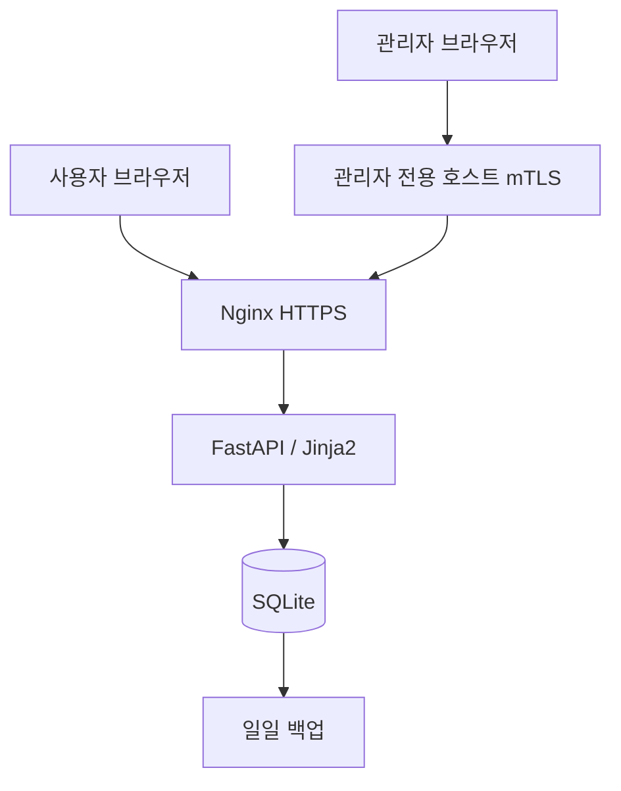

# 시스템 설계

사용자 호스트는 관리자 페이지/API를 차단한다. 관리자 호스트는 인증서 검증 성공 시에만 관리자 경로를 프록시한다. FastAPI는 loopback 또는 Unix socket으로만 바인딩하고 관리자 접근 신호는 신뢰된 Nginx가 덮어쓴 내부 헤더로 전달한다. 애플리케이션도 기본 거부하며 직접 접속을 금지한다.

## RS-001 초기 구현 경계
`app.main.create_app(settings=...)`가 앱 팩토리이자 `uvicorn --factory` 진입점이다. 불변 `Settings`는 앱별 `app.state.settings`에 보관한다. import/앱 생성/lifespan은 DB 생성·접속 및 외부 연결 없이 동작한다. 설정 우선순위와 필드는 README를 따른다. 템플릿/정적 파일 및 상대 DB 경로는 소스 위치를 기준으로 해석한다. 현재 관리자 접근 설정은 `deny`만 지원하고 관리자 경로는 404다. 위 프록시 접근 신호·mTLS·Origin/CSRF 설계의 구현 및 검증은 RS-006/008에 남아 있다.

## UI
사용자 `/`: 월 캘린더(가능/예약/불가/과거/선택), 선택 날짜 목록, 이름, 메모, 예약 버튼, 성공 화면 및 취소 토큰, 취소 폼. 모바일 우선; 상태는 색상 외 문자로 구분. 월을 넘겨 선택한 날짜도 유지. 실패 시 날짜 목록 갱신 및 안내.
관리자 `/admin`: 월별 캘린더 및 리스트, 예약 생성/수정/취소, 차단일 관리, 로그, 설정. 삭제 확인 및 오류 표시.

## DB 모델
- reservations: id UUID, name, memo, cancel_token_hash, status (CONFIRMED/CANCELLED), created_at, cancelled_at
- reserved_dates: date TEXT PRIMARY KEY, reservation_id FK nullable, type RESERVED/BLOCKED, memo; CHECK로 type과 FK null 여부 연계
- reservation_logs: id, reservation_id nullable, action, detail (날짜 전후 스냅샷, 토큰 제외), created_at
- settings: key PK, value
- schema_migrations: version PK, applied_at

SQLite foreign_keys=ON, WAL, busy_timeout 설정. 쓰기마다 BEGIN IMMEDIATE; 날짜 유효성/정책 검사 후 예약·점유·이력을 같은 트랜잭션에 삽입한다. 충돌은 409, busy timeout은 503. 복수 날짜 중 하나라도 충돌하면 롤백한다. 수정 시 기존 점유 해제와 새 점유 등록을 한 트랜잭션에서 실행한다. 취소 시 상태 및 로그 보존, 점유만 제거. 차단일도 동일 날짜 PK 사용. 과거 점유는 유지한다.

취소 토큰은 암호학적 난수 32바이트 이상, URL-safe 문자열로 1회 표시, SHA-256 해시만 저장. 요청 본문으로 전달하며 로그/URL/캐시에 넣지 않는다. 공개 응답에는 토큰·메모·이름을 제외한다. 중복 제출은 버튼 비활성화와 DB 제약으로 방어한다.
